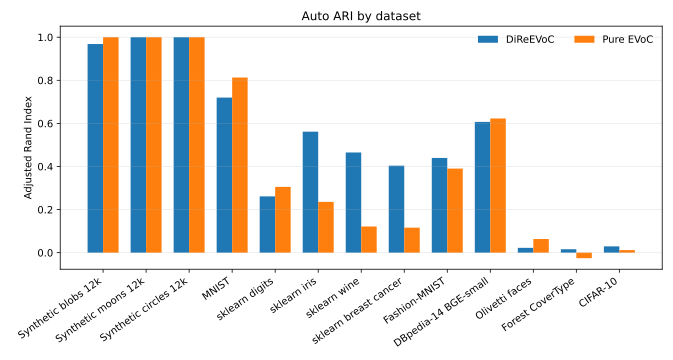
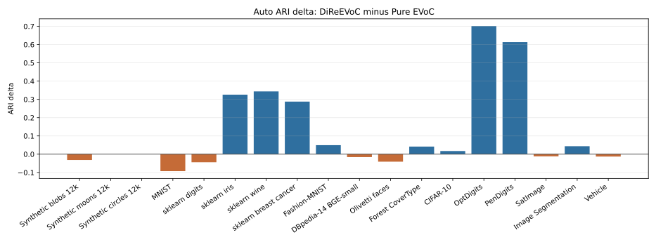
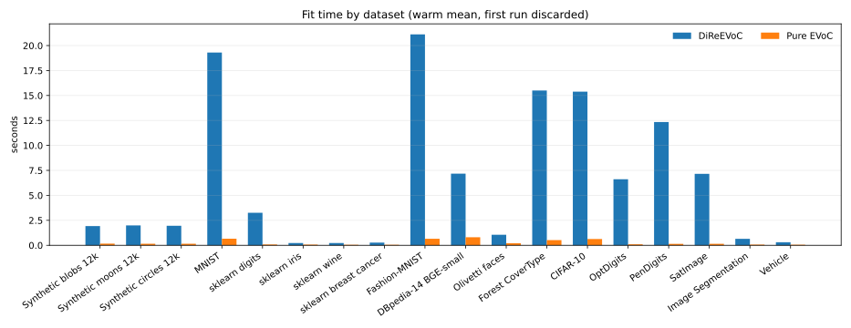
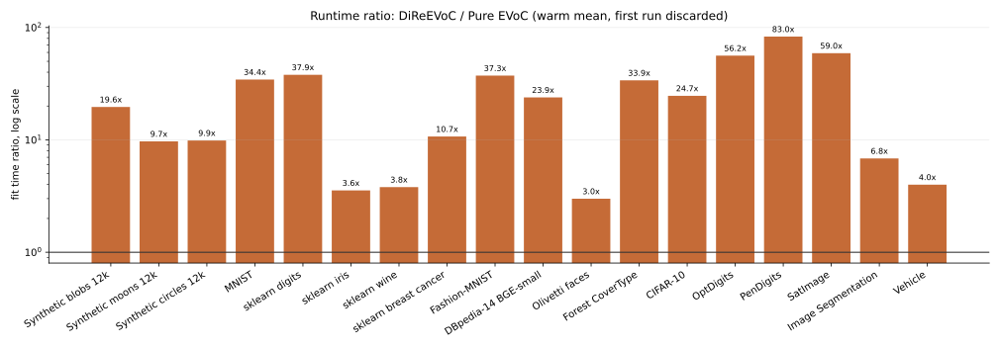
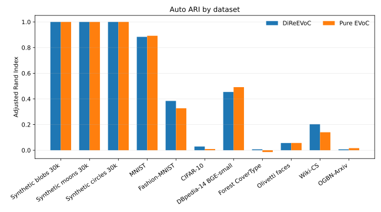
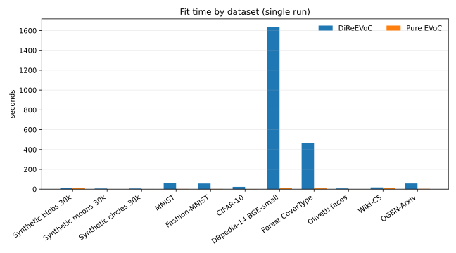

# dire-evoc

`dire-evoc` connects three pieces that are useful together:

- [DiRe-RAPIDS](https://github.com/sashakolpakov/dire-rapids) builds a GPU DiRe layout
  from high-dimensional embeddings.
- [EVoC](https://github.com/TutteInstitute/evoc) extracts density-based cluster layers.
- `dire-evoc` adds the bridge code: a one-call pipeline, intrinsic-dimension estimation
  from DiRe's existing kNN graph, GPU single-linkage-tree handoff, and out-of-sample
  label assignment.

The package is deliberately thin. It does not reimplement DiRe or EVoC; it makes their
shared boundary explicit and keeps the heavy GPU dependencies behind lazy imports.

## What You Get

**One-call DiRe -> EVoC pipeline**

```python
from dire_evoc import DiReEVoC

model = DiReEVoC(min_samples=10, random_state=0).fit(X)

labels = model.labels_                  # selected EVoC layer, -1 means noise
layout = model.layout_                  # DiRe layout clustered by EVoC
dimension = model.intrinsic_dimension_  # TwoNN estimate from DiRe's kNN graph
new_labels = model.predict(X_new)       # kNN vote in the original embedding space
```

**Intrinsic dimension without a second neighbour search**

DiRe already builds a k-nearest-neighbour graph. `dire-evoc` can estimate intrinsic
dimension directly from that graph:

```python
from dire_evoc import intrinsic_dimension, intrinsic_dimension_from_dire

dim = intrinsic_dimension_from_dire(fitted_reducer)
dim_reference = intrinsic_dimension(X, method="twonn")
```

The estimators handle the common cosine-normalized case correctly by converting cosine
or chordal distances to angular/geodesic distances before applying ratio-based ID
estimators.

**GPU Phase-2 clustering bridge**

EVoC's expensive clustering phase is the HDBSCAN* single-linkage tree on mutual
reachability distances. cuML can build that tree on the GPU; EVoC can then run its own
condense, persistence, and layer extraction logic unchanged.

```python
from dire_evoc.hybrid import hybrid_cluster_layers

layers, memberships, persistence = hybrid_cluster_layers(layout, min_samples=10)
```

**Out-of-sample prediction**

New points are assigned by a distance-weighted kNN vote against the original training
embeddings. Noise is treated as a competing label.

```python
from dire_evoc import prepare_reference, knn_vote_predict

reference = prepare_reference(X_train)
query = prepare_reference(X_new)
labels, membership = knn_vote_predict(query, reference, train_labels, n_neighbors=15)
```

## When It Helps

The strongest use case is medium-to-large embedding data where density-separated
structure is present and the DiRe layout is a better clustering substrate than the raw
vectors. The table below is from the checked CUDA Docker repro on an NVIDIA A10, using
the same dataset-specific EVoC `base_min_cluster_size` and `base_n_clusters` controls
for DiReEVoC and pure EVoC; see `docs/benchmarks.md` and the local
`artifacts/cuda-timing-repeats-default/` artifact tree. Timings are 20-run warm means
with the first run discarded; first-run and first-included means are recorded separately
in the metrics and alternate runtime figures.







| Dataset | DiReEVoC auto ARI | Pure EVoC auto ARI | Notes |
| --- | ---: | ---: | --- |
| Synthetic blobs 12k | 0.968 | 1.000 | Matched `base_min_cluster_size=100` |
| Synthetic moons 12k | 1.000 | 1.000 | Matched `base_min_cluster_size=100`, `base_n_clusters=2` |
| Synthetic circles 12k | 1.000 | 1.000 | Matched `base_min_cluster_size=100`, `base_n_clusters=2` |
| MNIST | 0.720 | 0.813 | Pure EVoC wins in this 24k HF-backed run |
| sklearn digits | 0.261 | 0.305 | Small image data; fixed-k favors Pure EVoC |
| sklearn iris | 0.562 | 0.236 | DiReEVoC auto win; fixed-k is close |
| sklearn wine | 0.465 | 0.121 | DiReEVoC auto win in this tuned run |
| sklearn breast cancer | 0.404 | 0.116 | DiReEVoC win; fixed-k is stronger |
| Fashion-MNIST | 0.440 | 0.390 | DiReEVoC win; stronger at fixed-k |
| DBpedia-14 BGE-small | 0.607 | 0.623 | Pure EVoC slightly wins in this 39.2k run |
| Olivetti faces | 0.022 | 0.063 | Tiny data; both poor |
| Forest CoverType | 0.016 | -0.026 | DiReEVoC slight win; both poor |
| CIFAR-10 | 0.029 | 0.012 | 30k images, average-pooled to 16x16 RGB (`d=768`) |

Runtime from the same CUDA run:

| Dataset | DiReEVoC fit | Pure EVoC fit |
| --- | ---: | ---: |
| Synthetic blobs 12k | 3.03s | 0.15s |
| Synthetic moons 12k | 1.43s | 0.15s |
| Synthetic circles 12k | 1.44s | 0.15s |
| MNIST | 20.37s | 0.59s |
| sklearn digits | 2.71s | 0.07s |
| sklearn iris | 0.20s | 0.06s |
| sklearn wine | 0.21s | 0.06s |
| sklearn breast cancer | 0.62s | 0.06s |
| Fashion-MNIST | 23.13s | 0.62s |
| DBpedia-14 BGE-small | 15.45s | 0.65s |
| Olivetti faces | 0.56s | 0.19s |
| Forest CoverType | 15.84s | 0.47s |
| CIFAR-10 | 14.87s | 0.60s |



A separate full-scale sweep uses one fit per dataset, full train+test image corpora where
available, and the same matched EVoC controls. The completed CUDA artifact tree is
`artifacts/scale-163-192-62-0/`; `timing_policy` is `single_run`.





| Scale dataset | n train | DiReEVoC auto ARI | Pure EVoC auto ARI | DiReEVoC fit | Pure EVoC fit |
| --- | ---: | ---: | ---: | ---: | ---: |
| Synthetic blobs 30k | 30,000 | 1.000 | 1.000 | 9.50s | 12.09s |
| Synthetic moons 30k | 30,000 | 1.000 | 1.000 | 6.40s | 0.48s |
| Synthetic circles 30k | 30,000 | 1.000 | 1.000 | 6.06s | 0.49s |
| MNIST full | 70,000 | 0.884 | 0.892 | 64.47s | 1.78s |
| Fashion-MNIST full | 70,000 | 0.384 | 0.327 | 56.68s | 1.81s |
| CIFAR-10 full | 60,000 | 0.029 | 0.009 | 23.08s | 1.65s |
| DBpedia-14 BGE-small full | 560,000 | 0.454 | 0.492 | 1,636.04s | 13.09s |
| Forest CoverType full | 581,012 | 0.007 | -0.014 | 465.55s | 8.11s |
| Olivetti faces full | 400 | 0.056 | 0.057 | 7.36s | 0.33s |
| Wiki-CS full | 11,701 | 0.203 | 0.140 | 17.47s | 11.74s |
| OGBN-Arxiv full | 169,343 | 0.007 | 0.016 | 57.21s | 2.73s |

The honest boundary:

- This is not a universal clustering-quality win.
- DiRe is data-hungry; tiny datasets and weak feature representations are poor fits.
- Layer selection is still a real failure mode. The tuned run makes moons/circles
  feasible by setting the known two-cluster base layer for both methods, but MNIST,
  digits, Fashion-MNIST, DBpedia, Olivetti, and CoverType still expose selector and
  substrate limits.
- A hard partition is often the wrong object on continuous manifolds. In that case,
  inspect the layout and intrinsic dimension before trusting cluster labels.
- The GPU Phase-2 speedup is regime-dependent. It helps at large `n` and low CPU core
  count, but the CPU path can win on small data or many-core machines.

## Installation

Base install:

```bash
python -m pip install -e .
```

The base package supports the CPU-tested pieces: intrinsic-dimension utilities,
out-of-sample voting, and package imports.

Full GPU pipeline install:

```bash
python -m pip install -e '.[rapids,dire,cluster]'
```

Those extras pull in the packages needed by `DiReEVoC` and `dire_evoc.hybrid`. RAPIDS
packages are CUDA-version-specific, so many users will prefer to install them in a RAPIDS
conda environment first and then install this project editable.

Documentation build dependencies:

```bash
python -m pip install -e '.[docs]'
```

## Quick Start

Run the bundled smoke example in an environment with the GPU stack installed:

```bash
python examples/quickstart.py
```

Generate a reproducible local benchmark/profile bundle with metrics and SVG figures:

```bash
python examples/benchmark_visuals.py --synthetic-blobs --n-samples 12000 \
  --test-fraction 0.2 --output-dir artifacts/benchmark-visuals
```

The visual benchmark example writes `metrics.json`, `metrics.csv`, `quality_ari.svg`,
`timing_breakdown.svg`, and `diagnostics.svg`. It reports DiReEVoC versus pure EVoC,
phase timings, intrinsic dimension from DiRe's existing kNN graph, selected-layer noise,
cluster counts, and optional hold-out prediction metrics.

Run the synthetic smoke suite, or run the broader default suite against the same pure
EVoC baseline:

```bash
python examples/benchmark_dataset_suite.py --list-datasets
python examples/benchmark_dataset_suite.py --datasets smoke \
  --output-dir artifacts/smoke-suite --timing-repeats 20
python examples/benchmark_dataset_suite.py --datasets default \
  --output-dir artifacts/dataset-suite --test-fraction 0.2 --timing-repeats 20
```

The `smoke` preset is only synthetic blobs, moons, and circles. The `default` suite keeps
those same three synthetic examples at the front of the larger reproducibility run, then
adds sklearn digits, iris, wine, breast cancer, MNIST, Fashion-MNIST, DBpedia-14
embeddings, Olivetti faces, Forest CoverType, and CIFAR-10. CIFAR-10 is average-pooled to
16x16 RGB features for this benchmark so it stays on the DiRe cuVS kNN path. Timing
summaries use warm means in `fit_seconds` by default, while `fit_seconds_first`,
`fit_seconds_mean_all`, and `fit_seconds_warm_mean` are also written. Rebuild the
README/Sphinx figures from local artifacts with `python scripts/plot_benchmark_metrics.py`.
OpenML is tried first by default. If OpenML fails, datasets that
are fully available in sklearn use the sklearn fallback first, as Forest CoverType does
through `fetch_covtype`; other mirrored OpenML datasets fall back to Hugging Face
(`ylecun/mnist`, `zalando-datasets/fashion_mnist`, or `uoft-cs/cifar10`).
OpenML-only datasets such as USPS, SVHN, UMIST faces, Letter,
OptDigits, PenDigits, SatImage, Segment, and Vehicle remain available by explicit slug.
Optional graph-feature datasets include Wiki-CS and OGBN-Arxiv when their extra loaders
are installed.

The default DiRe layout dimension is `n_components=8`. To check whether a smaller
layout is enough, and to tune EVoC controls without rebuilding DiRe for every trial, use
the cached-layout tuner. It builds one DiRe layout per value in `--n-components-grid`,
then sweeps EVoC-side controls on the cached layout:

```bash
python examples/benchmark_cached_layout_tuning.py \
  --npz artifacts/cuda/datasets/fashion_mnist.npz \
  --label Fashion-MNIST \
  --output-dir artifacts/cached-layout/fashion_mnist \
  --n-components-grid 4,8 \
  --base-min-cluster-size-grid 25,50,100 \
  --base-n-clusters-grid none,classes
```

The tuner writes `metrics.json` and `trials.csv`; compare `dire_layout_seconds`,
`cached_trial_seconds`, `full_once_seconds`, and ARI columns to separate layout cost from
EVoC tuning cost.

The full-scale timing hypothesis is different from the 20-run default suite: small
datasets favor pure EVoC because it has no DiRe layout overhead, while larger datasets
can expose pure EVoC's neighbour/MST cost and raw-space density limits. The `scale`
preset runs one fit per dataset, uses full dataset materializations where the loader can
provide them, and includes 30k synthetic controls plus full MNIST, Fashion-MNIST,
CIFAR-10, DBpedia-14 embeddings, Forest CoverType, Olivetti faces, Wiki-CS, and
OGBN-Arxiv:

```bash
python examples/benchmark_dataset_suite.py \
  --datasets scale \
  --output-dir artifacts/scale-suite \
  --prefer-hf \
  --timing-repeats 1 \
  --test-fraction 0.0 \
  --continue-on-error
```

CIFAR-10 is 60k images in the standard full train+test corpus. If the intended CIFAR
target is CIFAR-100 or a combined CIFAR run, add that as a separate dataset slug before
comparing the scale numbers. To regenerate the checked-in scale figures from local
artifacts, pass the scale artifact tree explicitly:

```bash
python scripts/plot_benchmark_metrics.py \
  --scale-artifacts artifacts/scale-163-192-62-0
```

Run the full CUDA Docker repro on a CUDA host and download the artifacts locally:

```bash
scripts/run_remote_cuda_repro.sh user@gpu-host
```

This syncs the working tree to the host, builds `dire-evoc:cuda128`, runs
`examples/run_cuda_repro.py` in Docker, and downloads `manifest.json`, logs, datasets,
`metrics.json`, `metrics.csv`, and SVG figures into `artifacts/cuda/`.

Minimal standalone intrinsic-dimension example:

```python
import numpy as np
from dire_evoc import intrinsic_dimension

rng = np.random.default_rng(0)
X = rng.normal(size=(5000, 12))

print(intrinsic_dimension(X, k=20, method="twonn"))
```

## Documentation

The Sphinx documentation lives in `docs/`.

```bash
python -m sphinx -b html docs docs/_build/html
```

Useful entry points:

- `docs/index.rst` - Sphinx documentation home.
- `docs/usage.md` - original long-form usage guide.
- `docs/benchmarks.md` - benchmark notes and results.
- `examples/benchmark_visuals.py` - reproducible benchmark metrics and SVG plots.
- `examples/` - quickstart and benchmark scripts.

## Development

```bash
python -m pip install -e '.[dev]'
python -m pytest
```

The CPU suite covers intrinsic dimension, out-of-sample voting, and layer selection. The
end-to-end pipeline test is skipped unless `cuml`, `dire_rapids`, and `evoc` are
installed.

## Project Status

Alpha. The CPU-importable pieces are tested without the GPU stack. The CUDA path has a
Docker repro in this repository and was run end-to-end on an NVIDIA A10. The hybrid path
uses cuML for the single-linkage tree and EVoC's own tree utilities for condense,
persistence, and layer extraction; it also supports an upstream
`build_cluster_layers(..., precomputed_linkage=...)` seam if EVoC exposes one.

## Credit

`dire-evoc` is the integration layer by Igor Rivin. It builds on EVoC by Leland McInnes
et al. at the Tutte Institute and DiRe-RAPIDS by Alexander Kolpakov and Igor Rivin.
