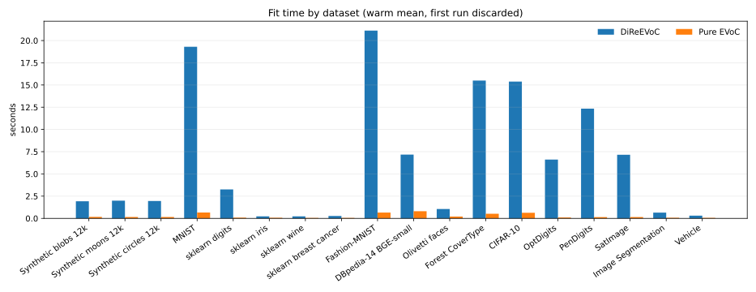
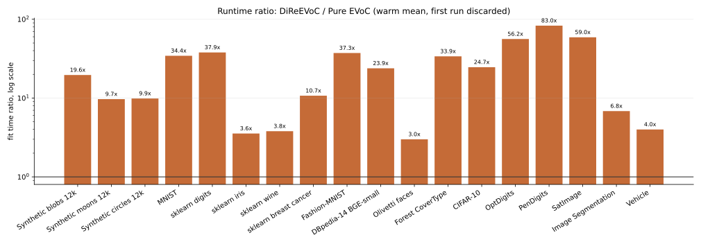
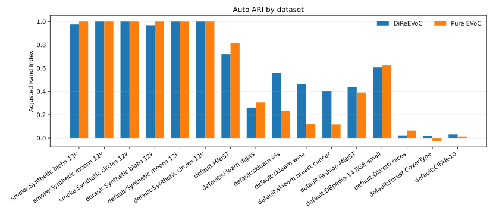
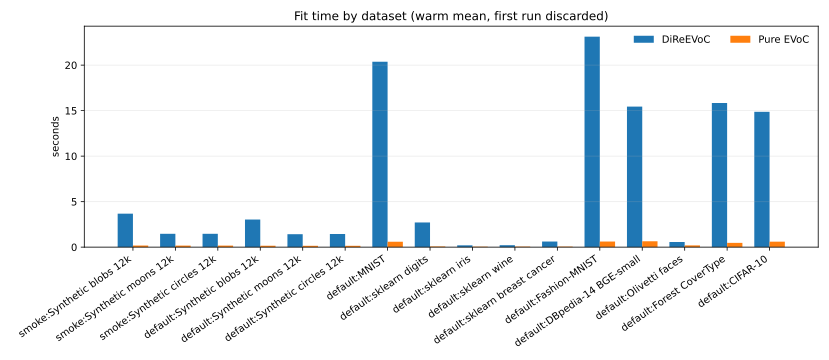
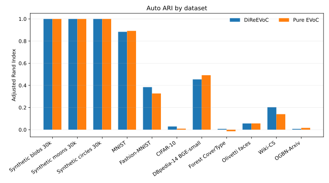
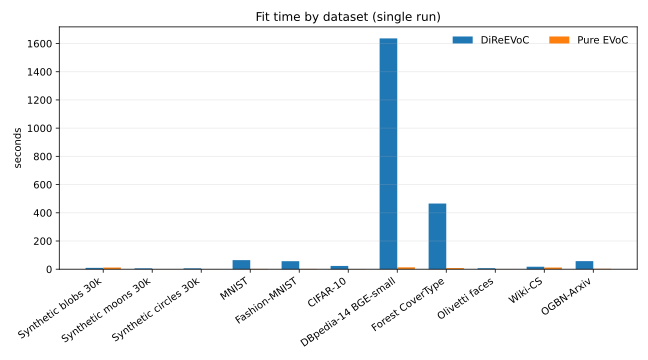
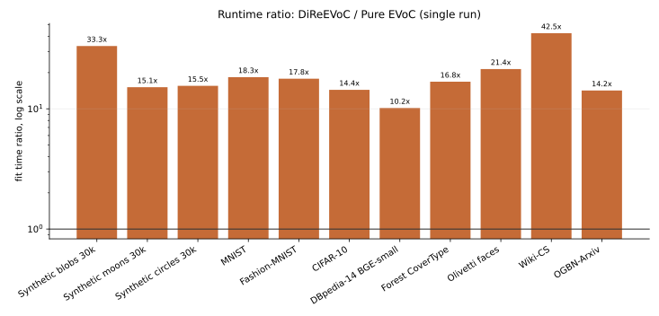
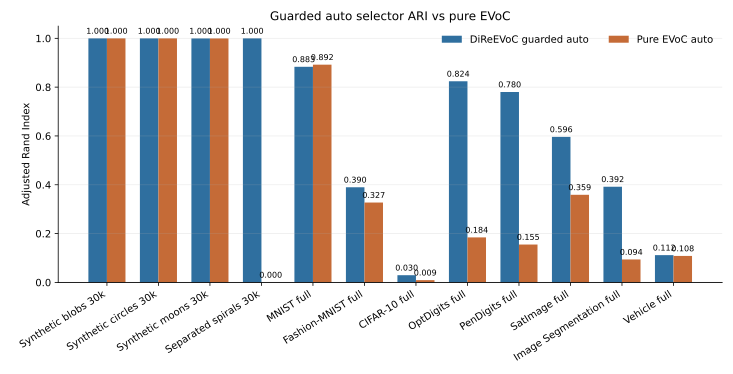
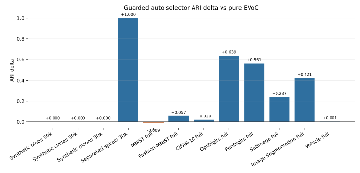
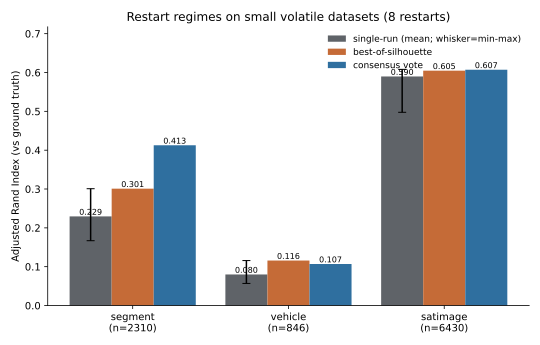

# Quality benchmarks: does DiRe->EVoC beat pure EVoC?

Reproduce with `examples/run_cuda_repro.py` or the SSH wrapper
`scripts/run_remote_cuda_repro.sh`. Each dataset is scored three ways:

- **auto** - operational under the declared run configuration: the layer the method
  actually selects.
- **oracle** - best ARI over layers the method produced; this removes selection error.
- **fixed-k** - the base layer forced to `k = n_classes`, isolating substrate quality.

"Pure EVoC" = `EVoC.fit_predict` on the original feature vectors. "DiReEVoC" = the same
EVoC clustering on a DiRe layout. ARI is against ground-truth labels.

## CUDA results

These numbers come from the CUDA Docker repro on an NVIDIA A10 using the Dockerfile in
this repository: CUDA 12.8 image, RAPIDS 26.2 Python packages. The run completed
successfully: quickstart, the 13-row original default suite, corrected CIFAR-10 rerun,
summary regeneration, the 5-dataset OpenML-extra suite, and artifact download all
returned exit code 0. The local artifact trees are
`artifacts/cuda-timing-repeats-default/`,
`artifacts/cuda-timing-repeats-openml-extra/`, and the merged
`artifacts/cuda-timing-repeats-combined/`. The regenerated default figures append the
OpenML-extra rows, so they summarize 18 datasets.

This run uses matched EVoC controls for both methods. The dataset suite chooses
`base_min_cluster_size` case-by-case, and uses `base_n_clusters=2` for the synthetic
moons and circles controls where the feasible benchmark target is known. Each timed fit
is repeated 20 times. The primary timing fields are warm means with the first run
discarded; first-run and first-included means are also recorded.

Operational auto ARI vs ground truth:

| dataset | n train | d | cls | DiReEVoC auto | pure EVoC auto | delta | fixed-k substrate |
|---|---:|---:|---:|---:|---:|---:|---|
| Synthetic blobs 12k | 9,600 | 32 | 8 | 0.968 | 1.000 | -0.032 | DiRe 1.000 vs 1.000 |
| Synthetic moons 12k | 9,600 | 8 | 2 | 1.000 | 1.000 | +0.000 | DiRe 1.000 vs 1.000 |
| Synthetic circles 12k | 9,600 | 8 | 2 | 1.000 | 1.000 | +0.000 | DiRe 1.000 vs 1.000 |
| MNIST | 24,000 | 784 | 10 | 0.720 | 0.813 | -0.093 | DiRe 0.772 vs 0.848 |
| sklearn digits | 1,438 | 64 | 10 | 0.261 | 0.305 | -0.044 | DiRe 0.803 vs 0.873 |
| sklearn iris | 120 | 4 | 3 | 0.562 | 0.236 | +0.326 | DiRe 0.562 vs 0.582 |
| sklearn wine | 142 | 13 | 3 | 0.465 | 0.121 | +0.344 | DiRe 0.303 vs 0.257 |
| sklearn breast cancer | 455 | 30 | 2 | 0.404 | 0.116 | +0.288 | DiRe 0.669 vs 0.511 |
| Fashion-MNIST | 24,000 | 784 | 10 | 0.440 | 0.390 | +0.049 | DiRe 0.399 vs 0.273 |
| DBpedia-14 BGE-small | 39,200 | 384 | 14 | 0.607 | 0.623 | -0.016 | DiRe 0.560 vs 0.625 |
| Olivetti faces | 320 | 4,096 | 40 | 0.022 | 0.063 | -0.041 | DiRe 0.014 vs 0.056 |
| Forest CoverType | 40,000 | 54 | 7 | 0.016 | -0.026 | +0.042 | DiRe 0.006 vs -0.033 |
| CIFAR-10 | 24,000 | 768 | 10 | 0.029 | 0.012 | +0.017 | DiRe 0.004 vs 0.002 |
| OptDigits | 4,496 | 64 | 10 | 0.848 | 0.147 | +0.701 | DiRe 0.840 vs 0.918 |
| PenDigits | 8,794 | 16 | 10 | 0.738 | 0.125 | +0.613 | DiRe 0.800 vs 0.762 |
| SatImage | 5,144 | 36 | 6 | 0.495 | 0.507 | -0.012 | DiRe 0.559 vs 0.507 |
| Image Segmentation | 1,848 | 19 | 7 | 0.179 | 0.135 | +0.044 | DiRe 0.547 vs 0.321 |
| Vehicle | 677 | 18 | 4 | 0.064 | 0.077 | -0.013 | DiRe 0.130 vs 0.103 |

The code default is OpenML first, then fallback. The recorded remote artifact was rerun
with the declared Hugging Face mirror option for MNIST, Fashion-MNIST, and CIFAR-10 after
OpenML proved unreliable on that host. Forest CoverType used the sklearn `fetch_covtype`
fallback directly because it is fully available in sklearn. CIFAR-10 uses 30k images
average-pooled from 32x32 RGB to 16x16 RGB (`d=768`) so DiRe stays on the cuVS kNN path;
raw `d=3072` CIFAR was not used for the recorded benchmark.

Timing from the same CUDA run:



| dataset | DiReEVoC warm fit | pure EVoC warm fit | DiRe mean all | pure mean all | intrinsic dim | matched base control |
|---|---:|---:|---:|---:|---:|---|
| Synthetic blobs 12k | 3.03s | 0.15s | 3.43s | 0.73s | 22.51 | min_samples=10, base_min_cluster_size=100 |
| Synthetic moons 12k | 1.43s | 0.15s | 1.65s | 0.15s | 2.03 | min_samples=10, base_min_cluster_size=100, base_n_clusters=2 |
| Synthetic circles 12k | 1.44s | 0.15s | 1.67s | 0.15s | 2.07 | min_samples=10, base_min_cluster_size=100, base_n_clusters=2 |
| MNIST | 20.37s | 0.59s | 20.75s | 1.17s | 13.86 | min_samples=10, base_min_cluster_size=100 |
| sklearn digits | 2.71s | 0.07s | 3.08s | 0.08s | 8.66 | min_samples=10, base_min_cluster_size=10 |
| sklearn iris | 0.20s | 0.06s | 0.51s | 0.06s | 2.92 | min_samples=10, base_min_cluster_size=5 |
| sklearn wine | 0.21s | 0.06s | 0.57s | 0.06s | 4.05 | min_samples=10, base_min_cluster_size=5 |
| sklearn breast cancer | 0.62s | 0.06s | 0.96s | 0.06s | 3.61 | min_samples=10, base_min_cluster_size=5 |
| Fashion-MNIST | 23.13s | 0.62s | 23.33s | 0.63s | 15.56 | min_samples=10, base_min_cluster_size=100 |
| DBpedia-14 BGE-small | 15.45s | 0.65s | 15.83s | 0.65s | 25.69 | min_samples=10, base_min_cluster_size=100 |
| Olivetti faces | 0.56s | 0.19s | 0.89s | 0.20s | 5.21 | min_samples=10, base_min_cluster_size=2 |
| Forest CoverType | 15.84s | 0.47s | 16.21s | 0.48s | 3.04 | min_samples=10, base_min_cluster_size=100 |
| CIFAR-10 | 14.87s | 0.60s | 15.30s | 1.51s | 26.39 | min_samples=10, base_min_cluster_size=100 |
| OptDigits | 6.00s | 0.11s | 6.31s | 0.68s | 10.19 | min_samples=10, base_min_cluster_size=5 |
| PenDigits | 12.29s | 0.15s | 12.62s | 0.15s | 6.27 | min_samples=10, base_min_cluster_size=5 |
| SatImage | 6.58s | 0.11s | 6.89s | 0.12s | 13.70 | min_samples=10, base_min_cluster_size=5 |
| Image Segmentation | 0.57s | 0.08s | 0.91s | 0.09s | 2.20 | min_samples=10, base_min_cluster_size=5 |
| Vehicle | 0.25s | 0.06s | 0.59s | 0.07s | 5.78 | min_samples=10, base_min_cluster_size=5 |



The smoke-only synthetic run and the default run are also merged into one bundle:
`artifacts/cuda-timing-repeats-combined/`.





## Scale CUDA run

The scale preset answers a different question from the 20-repeat default suite. It uses
one timed fit per dataset (`timing_policy=single_run`), full train+test image corpora
where available, full DBpedia-14 embeddings, full Forest CoverType, and graph-feature
datasets with working loaders. The completed CUDA artifact tree is
`artifacts/scale-163-192-62-0/`, and the run manifest reports success. Facebook Page-Page
was removed from the benchmark preset because the upstream PyG download URL returned 404;
Wiki-CS is the torch-geometric graph-feature row in the scale preset.



| dataset | n train | d | cls | DiReEVoC auto | pure EVoC auto | delta |
|---|---:|---:|---:|---:|---:|---:|
| Synthetic blobs 30k | 30,000 | 32 | 8 | 1.000 | 1.000 | +0.000 |
| Synthetic moons 30k | 30,000 | 8 | 2 | 1.000 | 1.000 | +0.000 |
| Synthetic circles 30k | 30,000 | 8 | 2 | 1.000 | 1.000 | +0.000 |
| MNIST | 70,000 | 784 | 10 | 0.884 | 0.892 | -0.008 |
| Fashion-MNIST | 70,000 | 784 | 10 | 0.384 | 0.327 | +0.057 |
| CIFAR-10 | 60,000 | 768 | 10 | 0.029 | 0.009 | +0.020 |
| DBpedia-14 BGE-small | 560,000 | 384 | 14 | 0.454 | 0.492 | -0.038 |
| Forest CoverType | 581,012 | 54 | 7 | 0.007 | -0.014 | +0.021 |
| Olivetti faces | 400 | 4,096 | 40 | 0.056 | 0.057 | -0.000 |
| Wiki-CS | 11,701 | 300 | 10 | 0.203 | 0.140 | +0.063 |
| OGBN-Arxiv | 169,343 | 128 | 40 | 0.007 | 0.016 | -0.009 |



| dataset | DiReEVoC single fit | pure EVoC single fit |
|---|---:|---:|
| Synthetic blobs 30k | 9.50s | 12.09s |
| Synthetic moons 30k | 6.40s | 0.48s |
| Synthetic circles 30k | 6.06s | 0.49s |
| MNIST | 64.47s | 1.78s |
| Fashion-MNIST | 56.68s | 1.81s |
| CIFAR-10 | 23.08s | 1.65s |
| DBpedia-14 BGE-small | 1,636.04s | 13.09s |
| Forest CoverType | 465.55s | 8.11s |
| Olivetti faces | 7.36s | 0.33s |
| Wiki-CS | 17.47s | 11.74s |
| OGBN-Arxiv | 57.21s | 2.73s |



## Guarded graph-component selector sweep

The selector branch adds an opt-in `selector="auto"` mode. It keeps the
coverage-weighted silhouette result as the fallback, then tests a stable connected-
component labelling from the DiRe layout graph near `ceil(intrinsic_dimension) + 1`
neighbours. The graph layer is accepted only when it matches an explicit
`base_n_clusters` control or passes fragmentation guards; otherwise the silhouette layer
is used.

This sweep is one matched, full-`n` run on an NVIDIA A10 (`timing_policy=single_run`):
DiReEVoC and pure EVoC are fit on the *same data* for every dataset, with matched
`base_min_cluster_size` and `base_n_clusters` controls, so every delta is strictly matched
— including OptDigits, PenDigits, SatImage, Image Segmentation, and Vehicle, which earlier
borrowed a smaller-`n` pure baseline. The selector artifact is
`artifacts/selector-auto-full/`, and the plotting script writes `selector_vs_pure.csv`
plus the figures below.





| dataset | n | d | DiReEVoC guarded auto | pure EVoC auto | delta | DiReEVoC fit | graph decision |
|---|---:|---:|---:|---:|---:|---:|---|
| Synthetic blobs 30k | 30,000 | 32 | 1.000 | 1.000 | +0.000 | 30.1s | fallback: no stable large components |
| Synthetic circles 30k | 30,000 | 8 | 1.000 | 1.000 | +0.000 | 9.9s | accepted: matches `base_n_clusters=2` |
| Synthetic moons 30k | 30,000 | 8 | 1.000 | 1.000 | +0.000 | 12.9s | accepted: matches `base_n_clusters=2` |
| Separated spirals 30k | 30,000 | 2 | 1.000 | ≈0.00 | ≈+1.00 | 18.8s | accepted: matches `base_n_clusters=3` |
| MNIST full | 70,000 | 784 | 0.883 | 0.892 | −0.009 | 113.7s | fallback: no stable large components |
| Fashion-MNIST full | 70,000 | 784 | 0.385 | 0.327 | +0.057 | 97.9s | fallback: no stable large components |
| CIFAR-10 full | 60,000 | 768 | 0.029 | 0.009 | +0.020 | 37.7s | fallback: no stable large components |
| OptDigits full | 5,620 | 64 | 0.823 | 0.184 | +0.639 | 22.8s | fallback: no stable large components |
| PenDigits full | 10,992 | 16 | 0.716 | 0.155 | +0.561 | 35.7s | rejected: too few graph clusters without `base_n_clusters` |
| SatImage full | 6,430 | 36 | 0.596 | 0.359 | +0.237 | 24.7s | fallback: no stable large components |
| Image Segmentation full | 2,310 | 19 | 0.515 | 0.094 | +0.421 | 14.7s | fallback: no stable large components |
| Vehicle full | 846 | 18 | 0.110 | 0.108 | +0.001 | 12.3s | rejected: too few graph clusters without `base_n_clusters` |

The guarded graph override fires only on circles/moons/spirals, where a stable small-`k`
component structure matches the supplied `base_n_clusters`; on PenDigits and Vehicle a
candidate forms but the guard rejects it, and everywhere else no stable large-component
candidate forms so the selector defers to coverage-weighted silhouette. The real-data
deltas (e.g. OptDigits/PenDigits/Segment) are therefore DiRe-layout effects, not graph
overrides. Timings are single-run, so expect run-to-run GPU variance.

The Separated spirals pure-EVoC entry needs an honest caveat. Earlier drafts reported it as
`n/a` because EVoC's label-propagation initializer calls `PCA(n_components=4)`, and
scikit-learn raises `ValueError: n_components=4 must be between 0 and
min(n_samples, n_features)` on any input with fewer than 4 features. That is a
dimensionality guard, not a verdict about clustering 2-D data. The benchmark now zero-pads
the same spirals to 4-D so the initializer runs, and pure EVoC completes with the matched
`base_n_clusters=3` scoring **ARI ≈ 0.00** (0.0003 in this run) — raw-space density
clustering cannot separate the interleaved spiral arms regardless of dimension. DiReEVoC
reaches `1.000` because the DiRe layout untangles the arms first. So the real delta is ≈
**+1.00**, but it
is a DiRe-embedding effect on a 2-D toy, not a selector effect and not an EVoC limitation.

## Layer selection

`DiReEVoC` uses coverage-weighted silhouette by default: mean silhouette over all points,
with noise contributing 0. This penalizes layers that score well only because they throw
many points away as noise. The current CUDA run still shows that layer selection is not
solved in general: MNIST, digits, and several tiny or weak-feature datasets have much
better fixed-k substrate scores than auto-selected scores.

## Graph fragment merge

Some DiRe layouts preserve the right connected geometry but EVoC emits adjacent pieces as
separate density fragments. The pipeline now uses DiRe's original-space kNN graph to
merge selected-layer fragments only when reciprocal cross-neighbor evidence or noise
bridges support the merge. It rejects merges that collapse the selected layer to one
cluster and rejects severe coverage-weighted-silhouette losses.

In this run, moons and circles use the known two-cluster base target for both methods and
both reach `1.000` ARI. Breast cancer remains a DiReEVoC win (`0.404` vs pure EVoC's
`0.116`), though weaker than the previous fragment-merge-only run. Collapse-to-one
merges are rejected on MNIST, digits, Fashion-MNIST, DBpedia-14, Olivetti, and Forest
CoverType.

## Adaptive smoothing

The tight synthetic-blobs failure was a layer-generation failure: the DiRe layout had a
perfect fixed-k substrate, but EVoC's default smoothing could generate only degenerate
high-noise layers. The pipeline retries a small grid of larger `min_samples` and
`base_min_cluster_size` values when the base clustering is mostly noise, then re-selects
using the same coverage-weighted score.

In the broad CUDA run, blobs reach `0.968` auto ARI using `min_samples=10` and
`base_min_cluster_size=100` under the default holdout split; the smoke-only all-training
run records `0.975`. DiReEVoC can still retry larger internal smoothing values when its
initial selected layer is mostly noise; the selected values are recorded in
`selected_min_samples_` and `selected_base_min_cluster_size_`.

## Restart consensus voting for small datasets

Single-run selection (`restarts=1`) is the matched-budget default, but on tiny datasets a
single seed is volatile. `DiReEVoC(restarts=N, restart_combine="consensus")` runs N
independently seeded fits and combines them by **sparse co-association voting**: a pair of
points is linked when it is a kNN-neighbour and shares a cluster in at least
`restart_threshold` of the runs, and the consensus clusters are the **connected
components** of that graph (union-find; never an n×n matrix, so it scales to the kNN
budget). It costs N× the per-run wall-clock.

An 8-restart experiment (`experiments/consensus_experiment.py`, A10, `selector="auto"`)
compares three regimes on ground-truth ARI:



| Dataset | n | single-run (mean, min–max) | best-of-silhouette | consensus vote | Δ vs mean | Δ vs best-sil |
| --- | ---: | --- | ---: | ---: | ---: | ---: |
| Image Segmentation | 2,310 | 0.230 (0.167–0.301) | 0.301 | **0.413** | **+0.183** | **+0.112** |
| Vehicle | 846 | 0.080 (0.057–0.116) | 0.116 | 0.107 | +0.027 | −0.009 |
| SatImage | 6,430 | 0.590 (0.498–0.608) | 0.605 | 0.607 | +0.017 | +0.002 |

The headline is **Image Segmentation** — the case where best-of-silhouette *fails* (internal
silhouette is anti-correlated with ARI there). Consensus voting beats both the single-run
mean (+0.18) and best-of-silhouette (+0.11) because it aggregates stable pairwise
co-occurrence across runs rather than trusting any one run's score. On Vehicle and SatImage
it is neutral-to-slightly-positive. Notes: the agreement threshold matters (0.4–0.5 best;
≥0.75 over-fragments); on Segment consensus produces more clusters than classes (k≈16) but
purer ones; absolute ARIs on these tiny sets are run-variant, so read the *relative*
three-way comparison, which is apples-to-apples within the run. Consensus voting is the
robust restart combiner; it is a small-dataset robustness tool, not a replacement for the
matched-budget single-run headline numbers.

## Honest conclusion

This run supports a narrower claim than the old README:

- Wins are dataset-dependent. DiReEVoC wins on iris, wine, breast cancer, Fashion-MNIST,
  CoverType, pooled CIFAR-10, OptDigits, PenDigits, and Image Segmentation; ties on
  moons and circles under the matched feasible controls; and loses on blobs, MNIST,
  DBpedia-14, sklearn digits, Olivetti, SatImage, and Vehicle in the auto metric.
- Fixed-k can disagree with auto. Several datasets have good fixed-k substrate scores but
  poor selected layers, so fixed-k and oracle numbers must not hide selector failures.
- Tiny data and weak image/tabular features are poor regimes. Olivetti, CIFAR-10,
  CoverType, Segment, and Vehicle are not strong quality wins in absolute ARI.
- DiRe layout construction dominates end-to-end time except where pure EVoC itself is
  slow.

## Compared with `master`

The `master` README was too broad. The CUDA repro now records 18 default-suite datasets
plus warm-run timing fields. Fashion-MNIST remains a DiReEVoC win (`0.440 vs 0.390`),
OptDigits and PenDigits are strong DiReEVoC auto wins (`0.848 vs 0.147` and
`0.738 vs 0.125`), moons and circles are feasible ties when both methods use the known
two-cluster base target, but DBpedia-14 still slightly favors pure EVoC in this 39.2k
run (`0.607 vs 0.623`). MNIST also favors pure EVoC (`0.720 vs 0.813`). Historical 20
Newsgroups and arXiv claims are not part of the default repro unless their loaders are
enabled explicitly.

## Reproduce

On a CUDA Docker host reachable by SSH:

```bash
scripts/run_remote_cuda_repro.sh user@gpu-host
```

This syncs the working tree to the host, builds the Docker image, runs
`examples/run_cuda_repro.py`, and downloads all JSON, CSV, log, dataset, and SVG
artifacts to `artifacts/cuda/`.

The dataset suite can also be run directly. Use `smoke` for only synthetic blobs, moons,
and circles, and use `default` for the larger reproducibility suite that includes those
same three synthetic datasets plus MNIST, Fashion-MNIST, DBpedia-14, CoverType, CIFAR-10,
OptDigits, PenDigits, SatImage, Image Segmentation, Vehicle, and the smaller
sklearn/Olivetti datasets:

```bash
python examples/benchmark_dataset_suite.py --datasets smoke \
  --output-dir artifacts/smoke-suite --timing-repeats 20
python examples/benchmark_dataset_suite.py --datasets default \
  --output-dir artifacts/dataset-suite --test-fraction 0.2 --timing-repeats 20
```

With repeated timings, `fit_seconds` is the warm mean with the first run discarded by
default (`--timing-primary warm_mean`). `fit_seconds_first`,
`fit_seconds_mean_all`, and `fit_seconds_warm_mean` are recorded separately. Rebuild the
README/Sphinx figures from existing artifacts with:

```bash
python scripts/plot_benchmark_metrics.py
```

When `artifacts/cuda-timing-repeats-openml-extra/` exists, the plotting script appends
those five OpenML rows to the default-suite figures and combined bundle. The extra rows
can also be reproduced directly:

```bash
python examples/benchmark_dataset_suite.py \
  --datasets optdigits,pendigits,satimage,segment,vehicle \
  --output-dir artifacts/openml-extra \
  --test-fraction 0.2 \
  --timing-repeats 20 \
  --continue-on-error
```

The default DiRe layout dimension is `n_components=8`. To test whether `4` is good
enough, and to avoid rebuilding DiRe while tuning EVoC-side controls, run the
cached-layout tuner on a prepared `.npz` dataset:

```bash
python examples/benchmark_cached_layout_tuning.py \
  --npz artifacts/cuda/datasets/fashion_mnist.npz \
  --label Fashion-MNIST \
  --output-dir artifacts/cached-layout/fashion_mnist \
  --n-components-grid 4,8 \
  --base-min-cluster-size-grid 25,50,100 \
  --base-n-clusters-grid none,classes
```

It writes `metrics.json` and `trials.csv`; use `dire_layout_seconds` for the one-time
layout cost, `cached_trial_seconds` for each EVoC trial on that layout, and
`full_once_seconds` for the cost of one layout plus one selected trial.

For the scale regime, do not repeat each dataset 20 times. The small-data benchmark is
expected to favor pure EVoC because pure EVoC has no DiRe layout overhead. The larger
question is whether pure EVoC's neighbour/MST cost and raw-space density quality degrade
on larger corpora. Use the one-run `scale` preset:

```bash
python examples/benchmark_dataset_suite.py \
  --datasets scale \
  --output-dir artifacts/scale-suite \
  --prefer-hf \
  --timing-repeats 1 \
  --test-fraction 0.0 \
  --continue-on-error
```

The preset uses 30k synthetic blobs/moons/circles, full MNIST and Fashion-MNIST when
OpenML or the Hugging Face train+test mirror is available, full CIFAR-10
(`60k`, not `100k`), full DBpedia-14 embeddings when materialized with `--full`, full
Forest CoverType, full Olivetti faces, Wiki-CS, and full OGBN-Arxiv. Rebuild the scale
figures from the downloaded artifact tree with:

```bash
python scripts/plot_benchmark_metrics.py \
  --scale-artifacts artifacts/scale-163-192-62-0
```
