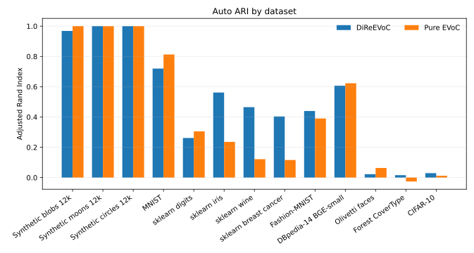
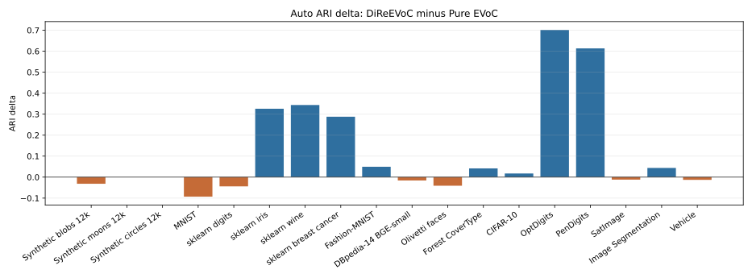
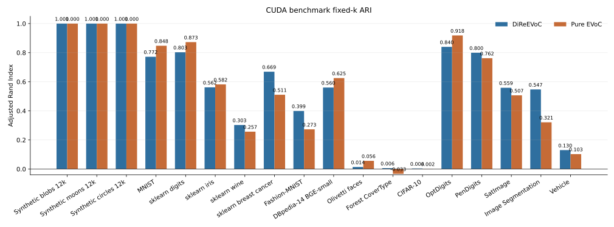
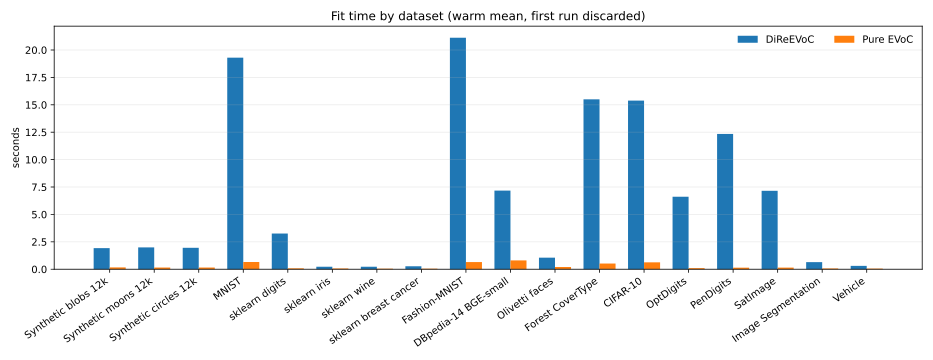
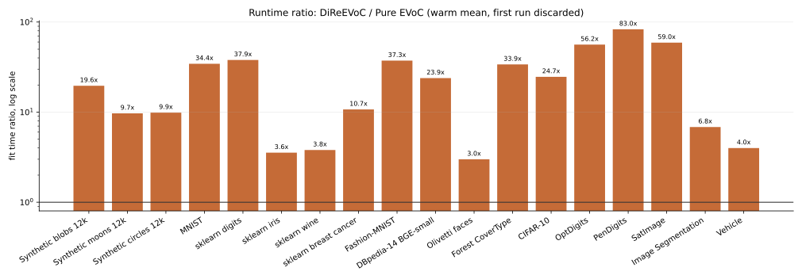
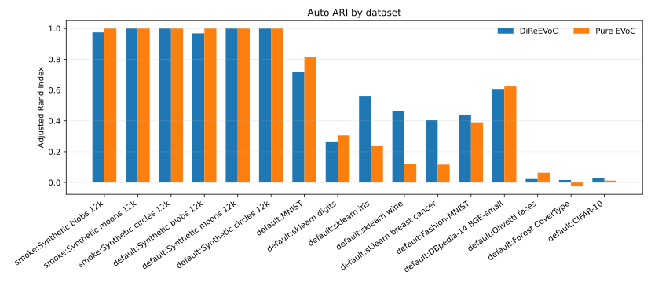
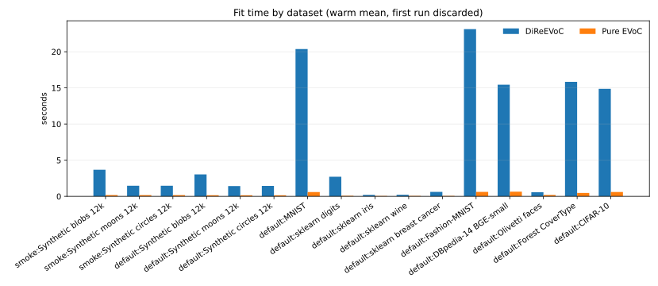

Benchmarks
==========

The benchmark scripts compare DiReEVoC against pure EVoC and separate three questions:

``auto``
   The layer selected by the method under the declared benchmark configuration.

``oracle``
   The best ARI among layers the method produced. This removes layer-selection error.

``fixed-k``
   The base layer forced to the known number of classes. This isolates substrate quality.

Quality summary
---------------

The current benchmark notes are in ``docs/benchmarks.md``. The headline result is
conditional, not universal. These figures summarize the CUDA Docker repro on an NVIDIA
A10, using matched dataset-specific EVoC base controls for DiReEVoC and pure EVoC.
Each timed fit is repeated 20 times; primary timing fields are warm means with the first
run discarded, and first-run and first-included means are recorded separately.

.. list-table::
   :header-rows: 1

   * - Dataset
     - n train
     - d
     - DiReEVoC auto ARI
     - Pure EVoC auto ARI
     - Result
   * - Synthetic blobs 12k
     - 9,600
     - 32
     - 0.968
     - 1.000
     - Pure EVoC slight win; fixed-k tie
   * - Synthetic moons 12k
     - 9,600
     - 8
     - 1.000
     - 1.000
     - Tie with ``base_n_clusters=2``
   * - Synthetic circles 12k
     - 9,600
     - 8
     - 1.000
     - 1.000
     - Tie with ``base_n_clusters=2``
   * - MNIST
     - 24,000
     - 784
     - 0.720
     - 0.813
     - Pure EVoC win
   * - sklearn digits
     - 1,438
     - 64
     - 0.261
     - 0.305
     - Pure EVoC slight win
   * - sklearn iris
     - 120
     - 4
     - 0.562
     - 0.236
     - DiReEVoC win
   * - sklearn wine
     - 142
     - 13
     - 0.465
     - 0.121
     - DiReEVoC win
   * - sklearn breast cancer
     - 455
     - 30
     - 0.404
     - 0.116
     - DiReEVoC win
   * - Fashion-MNIST
     - 24,000
     - 784
     - 0.440
     - 0.390
     - DiReEVoC win
   * - DBpedia-14 BGE-small
     - 39,200
     - 384
     - 0.607
     - 0.623
     - Pure EVoC slight win
   * - Olivetti faces
     - 320
     - 4,096
     - 0.022
     - 0.063
     - Tiny-data weak result
   * - Forest CoverType
     - 40,000
     - 54
     - 0.016
     - -0.026
     - DiReEVoC slight win; both poor
   * - CIFAR-10
     - 24,000
     - 768
     - 0.029
     - 0.012
     - DiReEVoC slight win; both poor

The fixed-k substrate comparison removes layer-selection and peak-granularity effects:

CIFAR-10 uses 30k images average-pooled from 32x32 RGB to 16x16 RGB (``d=768``). Raw
``d=3072`` CIFAR was not used for the recorded benchmark.

Runtime summary
---------------

The same CUDA run records fit timings for every dataset:

.. list-table::
   :header-rows: 1

   * - Dataset
     - DiReEVoC warm fit
     - Pure EVoC warm fit
     - DiRe mean all
     - Pure mean all
   * - Synthetic blobs 12k
     - 3.03s
     - 0.15s
     - 3.43s
     - 0.73s
   * - Synthetic moons 12k
     - 1.43s
     - 0.15s
     - 1.65s
     - 0.15s
   * - Synthetic circles 12k
     - 1.44s
     - 0.15s
     - 1.67s
     - 0.15s
   * - MNIST
     - 20.37s
     - 0.59s
     - 20.75s
     - 1.17s
   * - sklearn digits
     - 2.71s
     - 0.07s
     - 3.08s
     - 0.08s
   * - sklearn iris
     - 0.20s
     - 0.06s
     - 0.51s
     - 0.06s
   * - sklearn wine
     - 0.21s
     - 0.06s
     - 0.57s
     - 0.06s
   * - sklearn breast cancer
     - 0.62s
     - 0.06s
     - 0.96s
     - 0.06s
   * - Fashion-MNIST
     - 23.13s
     - 0.62s
     - 23.33s
     - 0.63s
   * - DBpedia-14 BGE-small
     - 15.45s
     - 0.65s
     - 15.83s
     - 0.65s
   * - Olivetti faces
     - 0.56s
     - 0.19s
     - 0.89s
     - 0.20s
   * - Forest CoverType
     - 15.84s
     - 0.47s
     - 16.21s
     - 0.48s
   * - CIFAR-10
     - 14.87s
     - 0.60s
     - 15.30s
     - 1.51s

The smoke-only synthetic run and the default run are also merged into one local bundle:
``artifacts/cuda-timing-repeats-combined/``.

Comparative metrics
-------------------

``auto``
   The operational result: the layer selected by the method without looking at labels.
   For DiReEVoC this is the coverage-weighted silhouette layer. For pure EVoC it is
   EVoC's selected layer.

``layer``
   A flat clustering extracted from EVoC's density hierarchy. Layer 0 is the finest
   clustering; later layers are coarser and usually have fewer clusters. Each layer is a
   full label vector over the samples, with ``-1`` marking noise.

``oracle``
   The best ARI among the layers the method produced. This is not an unsupervised result;
   it uses ground-truth labels after the fact to answer whether the hierarchy contained a
   good clustering even if the selector chose another layer.

``fixed-k``
   The base layer forced toward the known number of classes. This is the cleanest
   substrate test because DiReEVoC and pure EVoC are compared at the same target
   granularity.

``ARI`` and ``NMI``
   External agreement scores against known labels. ARI is stricter about pairwise
   agreement and corrected for chance; NMI measures shared label information.

``noise`` and ``clusters``
   Diagnostics for interpretation. A higher ARI with extreme noise may be less useful
   operationally than a slightly lower ARI that covers most points.

``intrinsic dimension``
   A TwoNN estimate computed from DiRe's existing neighbour distances. It is not a
   clustering score; it tells you whether the data looks locally low-dimensional or
   manifold-like relative to the ambient embedding dimension.

``timings``
   Wall-clock phase timings. In the reproducible profile, DiRe layout time and EVoC
   clustering time are separated so it is clear which part is the bottleneck on the
   current machine. Repeated timing fields include first-run and warm-only summaries.

Interpretation
--------------

The practical map is:

* DiReEVoC wins are dataset-dependent, not universal.
* Tiny datasets do not give DiRe enough data to form a reliable manifold; Olivetti is a
  weak result and fixed-k favors pure EVoC.
* Layer selection remains a real failure mode. Moons and circles are feasible when both
  methods use the known two-cluster base target, but several datasets still have much
  better fixed-k substrate quality than selected-layer quality.
* Continuous manifolds may not have a useful hard partition at all.
* CUDA accelerates the single-linkage-tree bridge, but DiRe layout construction can still
  dominate end-to-end time.

Compared with ``master``
------------------------

The old README was too broad. The CUDA repro now runs 13 datasets by default and records
all per-dataset figures plus warm-run timing fields. Fashion-MNIST remains a DiReEVoC win
(``0.440`` vs ``0.390``), moons and circles are perfect ties under matched
``base_n_clusters=2`` controls, but DBpedia-14 still slightly favors pure EVoC in this
39.2k run (``0.607`` vs ``0.623``). MNIST also favors pure EVoC (``0.720`` vs
``0.813``). Historical 20 Newsgroups and arXiv claims are not part of the default repro
unless their loaders are enabled explicitly.

Reproduce
---------

Use the CUDA repro wrapper to run on an SSH-accessible CUDA Docker host and download all
artifacts:

.. code-block:: bash

   scripts/run_remote_cuda_repro.sh user@gpu-host

The wrapper syncs the working tree to the host, builds the Docker image, runs
``examples/run_cuda_repro.py``, and downloads ``manifest.json``, logs, datasets,
``metrics.json``, ``metrics.csv``, and SVG figures into ``artifacts/cuda/``.

The dataset suite can also be run directly. Use ``smoke`` for only synthetic blobs,
moons, and circles, and use ``default`` for the larger reproducibility suite that keeps
those same three synthetic datasets and then adds MNIST, Fashion-MNIST, DBpedia-14,
CoverType, CIFAR-10, and the smaller sklearn/Olivetti datasets:

.. code-block:: bash

   python examples/benchmark_dataset_suite.py --datasets smoke \
      --output-dir artifacts/smoke-suite --timing-repeats 20
   python examples/benchmark_dataset_suite.py --datasets default \
      --output-dir artifacts/dataset-suite --test-fraction 0.2 --timing-repeats 20

With repeated timings, ``fit_seconds`` is the warm mean with the first run discarded by
default (``--timing-primary warm_mean``). ``fit_seconds_first``,
``fit_seconds_mean_all``, and ``fit_seconds_warm_mean`` are recorded separately. Rebuild
the README/Sphinx figures from existing artifacts with:

.. code-block:: bash

   python scripts/plot_benchmark_metrics.py

For a single local benchmark with prepared data:

.. code-block:: bash

   python examples/benchmark_quality.py --npz /path/to/data.npz --label "Dataset name"

For metrics files and SVG plots, use:

.. code-block:: bash

   python examples/benchmark_visuals.py --synthetic-blobs --n-samples 12000 \
      --test-fraction 0.2 --output-dir artifacts/benchmark-visuals

The output directory contains ``metrics.json``, ``metrics.csv``, ``quality_ari.svg``,
``timing_breakdown.svg``, and ``diagnostics.svg``. Use ``--npz`` or ``--openml`` to run
the same profile on prepared data.
