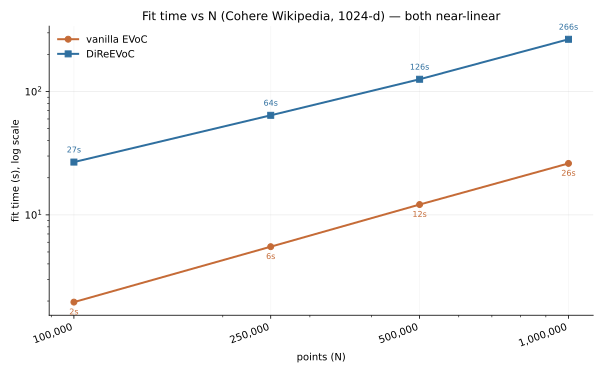
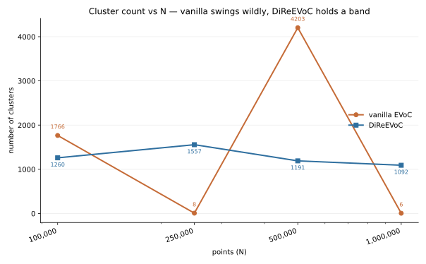
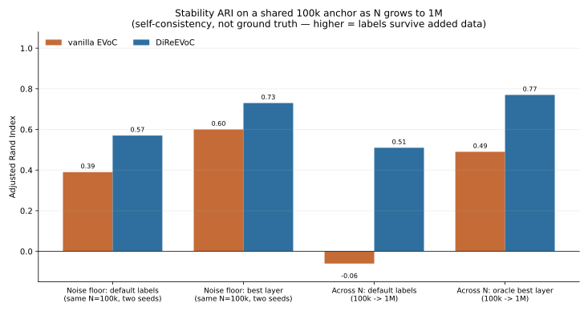

Scaling and stability at one million points
===========================================

A natural worry about clustering a million high-dimensional embeddings is that the base
algorithm simply never returns. This page reports a direct measurement on real data that
answers two questions: **does vanilla EVoC return at a million points, and is its
clustering stable at that scale?** The headline is that vanilla EVoC *does* return, quickly,
so runtime is not the concern. The concern is stability: its labelling shifts substantially
as more data is added, and at this scale a clustering is only useful if it holds as the
corpus grows. That stability, not the runtime, is what DiRe preprocessing improves.

Setup
-----

- **Data**: ``Cohere/wikipedia-2023-11-embed-multilingual-v3`` (English), 1024-dimensional
  precomputed paragraph embeddings, streamed and cached to disk in stream order so that the
  first 100k rows are a subset of every larger prefix.
- **Hardware**: a single NVIDIA GH200. DiReEVoC uses the GPU (cuVS k-NN and cuML); vanilla
  ``evoc.EVoC`` runs its own NN-descent k-NN and Boruvka MST on CPU.
- **Methods**: *vanilla* is ``evoc.EVoC().fit`` on the raw 1024-d vectors; *dire* is
  ``dire_evoc.DiReEVoC().fit``, which clusters an 8-d DiRe layout of the same vectors.
- **Reproduce (push-button)**: ``scripts/run_remote_cuda_scaling.sh user@gpu-host`` mirrors
  the general-benchmark remote runner — it syncs the tree, builds the CUDA image, runs
  ``examples/run_cuda_scaling.py`` (cache → ``scale_compare`` → ``stability``) on the GPU,
  rsyncs the artifact tree back to ``artifacts/cuda-scaling/``, and rebuilds the figures on
  this page with ``scripts/plot_scaling_metrics.py --artifacts artifacts/cuda-scaling``. The
  individual stages — ``experiments/cache_embeddings.py``, ``experiments/scale_compare.py``
  (timing), ``experiments/stability.py`` (stability) — can also be run by hand. Each fit runs
  in an isolated subprocess under a wall-clock watchdog, and a small warmup fit precedes every
  timed fit so numba and cuVS JIT compilation are excluded from the reported time.

Timing: both scale near-linearly, vanilla never stalls
------------------------------------------------------

.. list-table::
   :header-rows: 1

   * - N
     - vanilla fit
     - dire fit
     - vanilla clusters
     - dire clusters
   * - 100,000
     - 2.0 s
     - 26.8 s
     - 1766
     - 1260
   * - 250,000
     - 5.5 s
     - 64.2 s
     - 8
     - 1557
   * - 500,000
     - 12.1 s
     - 126.0 s
     - 4203
     - 1191
   * - 1,000,000
     - 26.2 s
     - 265.8 s
     - 6
     - 1092

Empirically the fit time grows as roughly :math:`N^{p}` with :math:`p \approx 1.13` for
vanilla and :math:`p \approx 0.97` for dire -- both effectively linear. Vanilla clusters a
million 1024-d vectors in **26 seconds**; the fear that it runs forever is unfounded.
DiReEVoC is about **ten times slower** at every scale, the fixed cost of building the DiRe
layout, but it is also linear. Runtime is not the story.

The cluster counts are. Vanilla's swing wildly with ``N`` -- 1766, 8, 4203, 6 -- while
dire stays in a tight band (1092 to 1557) with intrinsic dimension pinned at 11.4 to 11.6
across the whole range. That is the first sign that vanilla's *fast* answer is not a
*stable* answer.

Stability: ARI on a shared anchor set
-------------------------------------

Because the first 100k points are common to every run, we can measure the quantity that
actually matters: as ``N`` grows from 100k to 1M, do those same anchor points keep their
cluster assignment, or does the labelling churn? We score this with the Adjusted Rand Index
(ARI) of the anchor labels at one ``N`` against the next -- a label-invariant agreement
measure. Each method is judged against itself.

Two confounds are controlled explicitly:

- **Selector versus algorithm.** EVoC produces a stack of cluster *layers* and then selects
  one. We report both the agreement of the default selected labels and the *oracle*
  best-matching-layer agreement, which removes selection error.
- **Run-to-run nondeterminism.** We refit at the *same* ``N`` (100k) with two seeds and
  report that ARI as a noise floor. An across-``N`` drop counts as real instability only if
  it falls below this floor.

.. list-table::
   :header-rows: 1

   * - Measurement (ARI on shared 100k anchor)
     - vanilla
     - dire
   * - noise floor -- default labels, same N, two seeds
     - 0.39
     - 0.57
   * - noise floor -- best layer, same N, two seeds
     - 0.60
     - 0.73
   * - default labels across N (100k to 1M)
     - ~0 (-0.06)
     - 0.48 to 0.54
   * - oracle best layer across N (100k to 1M)
     - 0.45 to 0.52
     - 0.54 to 1.00

Reading the table:

- **Vanilla EVoC is unstable at the algorithm level.** Its across-``N`` agreement is about
  zero -- *below* its own seed-noise floor of 0.39 -- so adding data does not merely perturb
  the clustering, it replaces it. Even the oracle layer-matcher, given a perfect selector,
  never exceeds about 0.5. This is not an artifact of EVoC's layer selection; the layers
  themselves do not survive added data.
- **DiReEVoC is robust to scale.** Its across-``N`` agreement (about 0.5) is statistically
  indistinguishable from its same-seed floor (0.57): growing the data tenfold perturbs the
  labelling *no more than changing the random seed does*. The oracle best-layer agreement
  reaches 1.00 at the largest step, showing the underlying layer structure is essentially
  preserved.

What this does and does not claim
---------------------------------

The defensible, scale-related claim is that **vanilla EVoC's clustering collapses under
added data while DiReEVoC's does not**: DiRe buys *robustness to scale*, not speed.

It is **not** a claim that DiReEVoC is reproducible in an absolute sense. Its fixed-``N``
floor is only 0.57 (0.73 at the best layer), so neither method is deterministic at a given
``N``. Part of that variance is the layer selector -- the oracle floor exceeds the default
floor for both methods -- and part is likely cuVS k-NN nondeterminism. Turning "robust to
scale" into "reproducible" would require forcing a deterministic k-NN backend and/or
averaging over seeds, then re-measuring the floor. That is future work, not a result
claimed here.

.. note::

   These figures were produced on a RAPIDS 26.04 environment in which a pip-installed
   CUDA-13.0 ``libnvJitLink`` shadowed conda-forge's CUDA-13.2 copy, breaking cuVS and cuML
   imports (``undefined symbol: __nvJitLinkComplete_13_2``). The fix is to ensure the conda
   library loads first, for example a conda ``activate.d`` hook that prepends
   ``$CONDA_PREFIX/lib/libnvJitLink.so.13.*`` to ``LD_PRELOAD``.
